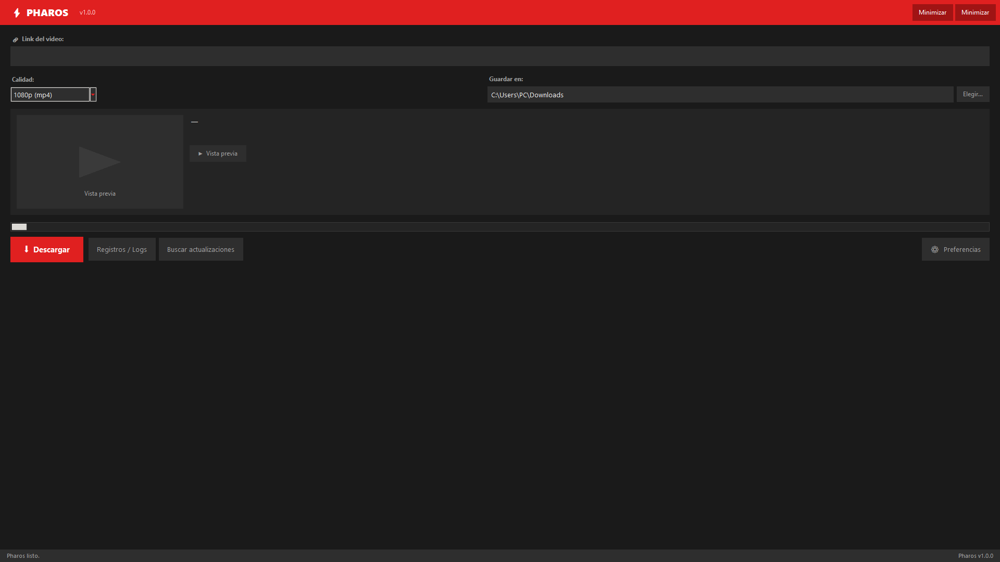

# ⚡ Pharos – Video Downloader

<p align="center">
  
  
  
  
  
</p>

**Pharos** es una interfaz gráfica moderna para descargar videos y audio usando [yt-dlp](https://github.com/yt-dlp/yt-dlp) y [ffmpeg](https://ffmpeg.org/).  
Pega el link, elige la calidad y descarga — sin comandos.

---

## ✨ Características

| Función | Descripción |
|---|---|
| 🎨 **Interfaz moderna** | Diseño oscuro con acento rojo/blanco |
| 🌐 **Multiidioma** | Español e inglés (seleccionable en ⚙ Preferencias) |
| ▶ **Vista previa** | Muestra título, canal y duración del video antes de descargar |
| 📋 **Ventana de Logs** | Registros detallados en ventana separada |
| 🔄 **Buscar actualizaciones** | Botón manual + verificación automática al iniciar |
| ⛶ **Pantalla completa** | Botón y atajo `F11`; `Esc` para salir |
| 🗕 **Minimizar** | Botón directo en la barra de título |
| 📁 **Calidades** | 1080p, 720p, 480p (mp4) y solo audio (mp3) |
| ⚙ **Preferencias persistentes** | Idioma y comportamiento al arrancar guardados en `pharos_settings.json` |

---

## 🖼 Interfaz

<p align="center">
  
</p>


https://github.com/user-attachments/assets/23c916e5-54f2-408c-8d02-a95be36093b3


---

## 🏗 Estructura del proyecto

```
Pharos/
├── main.py                        # ▶ Punto de entrada — ejecuta esto
├── pharos/                        # Paquete principal
│   ├── constants.py               # Colores, calidades, versión
│   ├── i18n.py                    # Traducciones (Translator)
│   ├── settings.py                # Preferencias JSON (SettingsManager)
│   ├── updater.py                 # Actualizaciones GitHub (Updater)
│   ├── downloader.py              # Lógica yt-dlp (Downloader)
│   └── ui/
│       ├── styles.py              # Tema visual (ThemeManager)
│       ├── log_window.py          # Ventana de logs
│       ├── settings_window.py     # Ventana de preferencias
│       └── app.py                 # Ventana principal (App)
├── pharos_settings.json           # Preferencias guardadas (auto-generado)
└── README.md
```

> Arquitectura SOLID: cada módulo tiene una única responsabilidad y las dependencias se inyectan, no se crean internamente.

---

## 🔧 Requisitos

- **Windows 10 u 11**
- **Python 3.10 o superior** ([descargar](https://www.python.org/downloads/)) — marca **Add Python to PATH**
- **yt-dlp** y **ffmpeg**
- *(Opcional)* **Pillow** — para mostrar miniatura en la vista previa

---

## 🚀 Instalación

### 1. Clona el repositorio

```bash
git clone https://github.com/JhonnydLeon/Pharos.git
cd Pharos
```

### 2. Instala yt-dlp y ffmpeg

```bash
winget install yt-dlp.yt-dlp
winget install Gyan.FFmpeg
```

> Cierra y vuelve a abrir la terminal tras instalarlos.

### 3. *(Opcional)* Instala Pillow para miniaturas

```bash
pip install Pillow
```

### 4. Ejecuta el programa

```bash
python main.py
```

---

## 📦 Crear ejecutable .exe

```bash
pip install pyinstaller
python -m PyInstaller --onefile --noconsole main.py --name Pharos
```

El ejecutable quedará en `dist\Pharos.exe`.

---

## 🌐 Idiomas

Cambia el idioma en **⚙ Preferencias** — el cambio se aplica de inmediato y se guarda para la próxima sesión.

---

## 🔄 Actualizaciones

1. **Automáticamente al iniciar** — activa/desactiva en ⚙ Preferencias.
2. **Manual** — botón **Buscar actualizaciones** en la interfaz principal.

---

## ⚠ Aviso

Usa Pharos únicamente con contenido que tengas derecho a descargar.  
Este proyecto no está afiliado a yt-dlp, ffmpeg ni YouTube.

---

## 📄 Licencia

MIT
